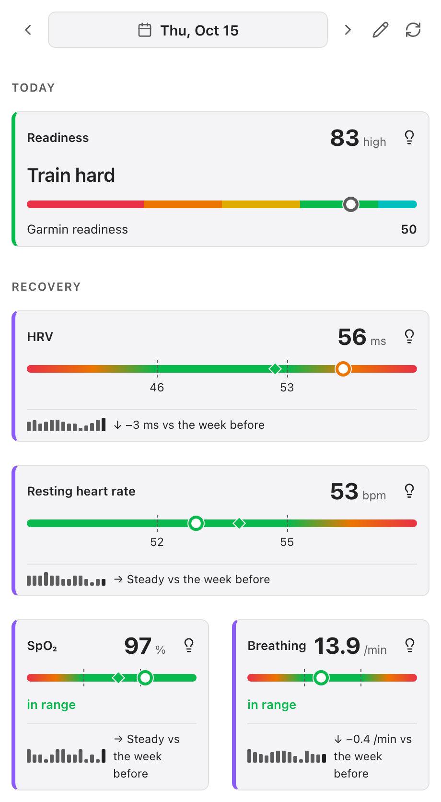
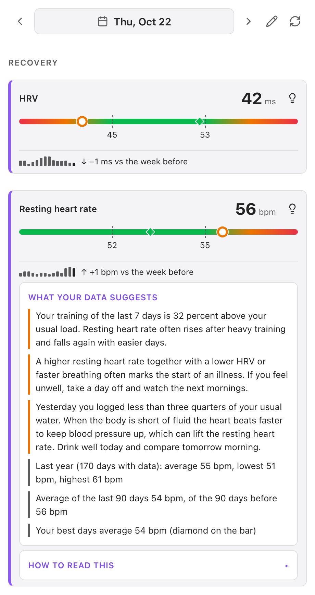
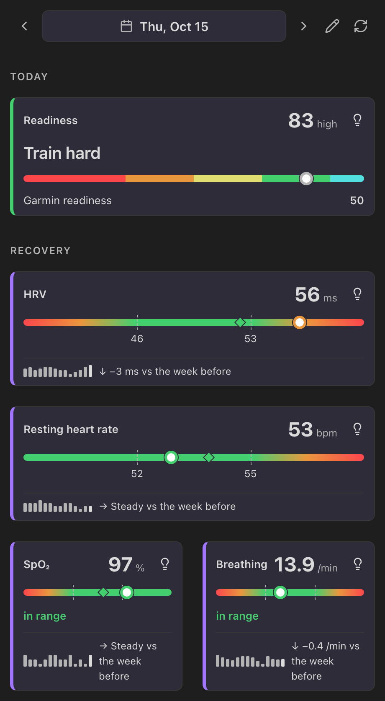
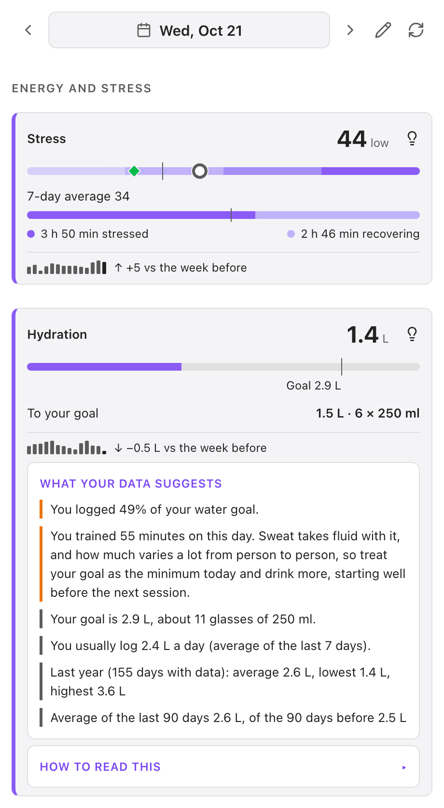
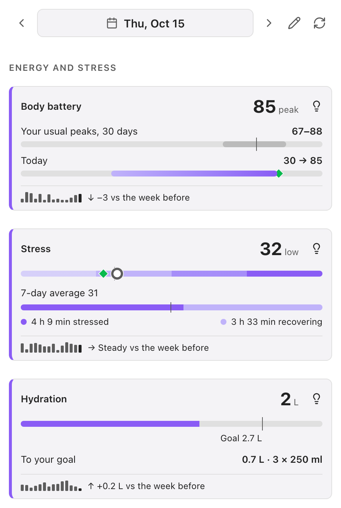
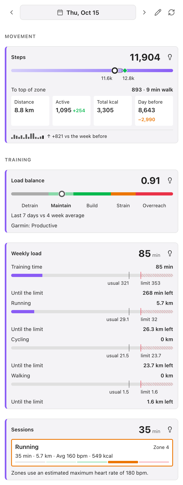

[English](README.md) · [Deutsch](README.de.md) · [中文](README.zh.md) · [日本語](README.ja.md) · [Español](README.es.md) · **Français**

# Garmin Health Sync

**Un compagnon pour vos notes quotidiennes.** Garmin Health Sync apporte les chiffres qui comptent de votre montre Garmin dans vos notes quotidiennes Obsidian et, si vous le souhaitez, montre où vous en êtes par rapport à votre propre normalité. Ce n’est pas une copie de Garmin Connect : le but est de vous aider à prendre les bonnes décisions pour la journée.

**Deux façons de l’utiliser**

- **Rester simple.** Connectez-vous et activez les mesures voulues. Elles sont écrites dans vos notes quotidiennes sous forme de propriétés interrogeables avec Dataview, et l’évaluation reste la vôtre.
- **Ajouter des visuels à côté de vos notes.** Activez le **panneau latéral** dans les réglages pour des cartes sur la disponibilité, la récupération, le sommeil, l’énergie, le mouvement et l’entraînement, comparées à votre propre plage habituelle. L’ampoule de chaque carte indique ce que vos données suggèrent aujourd’hui. [Ce que montre chaque carte et comment elle est calculée](docs/panel-cards.md).

<p>



</p>

> **Fonctionne sur ordinateur et sur mobile** (Windows, macOS, Linux, iOS, Android). Ce plugin utilise l’API interne de Garmin Connect ; il n’existe pas d’API tierce officielle. Vous vous connectez avec votre e-mail et votre mot de passe Garmin (et le code de vérification si vous utilisez la validation en deux étapes). Si Garmin bloque cette tentative, une connexion alternative par navigateur est proposée.

## Documentation

- [Réglages](docs/settings.md) — chaque réglage
- [Mesures](docs/metrics.md) — chaque propriété écrite dans vos notes
- [Cartes du panneau latéral](docs/panel-cards.md) — ce que montre chaque carte, quelle décision quotidienne elle aide à prendre et comment elle est calculée
- [Interprétations sous l’ampoule](docs/panel-insights.md) — quand chaque affirmation apparaît et sur quoi elle repose
- [Notes d’historique et remplissage](docs/history.md) — comment l’historique est conservé et construit
- [Meilleur personnel](docs/personal-best.md) — comment sont calculés le repère des meilleurs jours et le rang parmi tous vos jours
- [Dépannage](docs/troubleshooting.md) — connexion, mesures manquantes, panneau, notes et remplissage
- [Journal des modifications](CHANGELOG.md) — ce qui a changé à chaque version

## Fonctionnalités

- **Synchronisation automatique au démarrage** — vérifie les 7 derniers jours et complète les données de santé manquantes
- **Mode attente de note** — laisse éventuellement la synchronisation automatique attendre qu’un autre outil (Templater, Calendar, une synchronisation externe) crée la Daily Note, au lieu de la créer elle-même
- **Synchronisation manuelle** — synchronisez n'importe quelle Daily Note ouverte via la palette de commandes
- **Remplissage rétroactif** — synchronisation en masse d'une plage de dates (par ex. les 3 derniers mois)
- **Plus de 30 métriques** — pas, score de sommeil, HRV, stress, Body Battery, SpO2, poids, et plus
- **Suivi des activités** — chaque entraînement apparaît sous forme de résumé lisible
- **Lieu d'entraînement** — nom du lieu obtenu par géocodage inverse de votre première activité GPS
- **Détection intelligente** — détecte automatiquement le chemin et le format de vos Daily Notes depuis Periodic Notes ou le plugin natif Daily Notes
- **Support des sous-dossiers** — trouve les Daily Notes existantes dans les dossiers imbriqués (par ex. `Journal/2024-07/`) et crée des sous-dossiers par date lorsque le format du nom de fichier contient `/` (par ex. `YYYY/YYYY-MM-DD` → `Journal/2026/2026-08-04.md`)
- **Détection automatique de la langue** — la langue de l'interface est définie selon la langue de votre Obsidian (EN, DE, ZH, JA, ES, FR)
- **Données structurées optionnelles** — champ `trainings` lisible par machine pour des requêtes Dataview avancées
- **Préfixe des propriétés** — ajoute éventuellement le préfixe `ohs_` à toutes les propriétés frontmatter pour éviter les conflits de noms avec d’autres plugins
- **Journal de style de vie (habitudes)** — synchronise éventuellement les habitudes saisies dans Garmin Connect (oui/non ou un nombre, comme des tasses de café) sous forme de propriétés `lifestyle_<nom>` ; la carte Habitudes du panneau latéral montre chaque habitude et, avec assez de données, l’allure de votre VFC et de votre fréquence cardiaque au repos la nuit suivante
- **Panneau latéral santé** — barre latérale droite optionnelle avec des cartes pour la récupération, le sommeil, l’énergie, le mouvement, la forme et l’entraînement, comparées à votre propre plage habituelle ; touchez l’ampoule d’une carte pour voir ce que suggèrent vos données et comment c’est calculé ; à activer dans **Réglages → Garmin Health Sync → Panneau latéral**
- **Notes d’historique** — conservez en option chaque jour récupéré dans de petites notes mensuelles en markdown, pour que le panneau fonctionne aussi les jours sans note quotidienne et que les données se synchronisent avec votre coffre
- **Propriétés des notes quotidiennes** — repliez le bloc de propriétés à l’ouverture d’une note ou masquez les propriétés Garmin que le panneau affiche déjà

## Sortie Frontmatter

### Métriques

```yaml
---
steps: 15185
resting_hr: 69
sleep_score: 81
sleep_duration: 7h 43min
hrv: 39
stress: 30
vo2_max: 48
workout_location: Bad Honnef, Deutschland
---
```

**Body Battery :** `body_battery` est la valeur *charged* de Garmin, la somme de tous les gains de Body Battery de la journée (surtout la recharge nocturne), pas le niveau actuel. Activez `body_battery_min` et `body_battery_max` pour le niveau le plus bas et le plus haut de la journée, ce que l'application Garmin affiche dans son historique.

### Activités

Chaque entraînement est écrit comme une clé frontmatter avec une chaîne de résumé :

```yaml
---
hiking: 8.2 km · 157min · Ø105 bpm · 696 kcal
e_bike: 22.1 km · 65min · Ø112 bpm · 420 kcal
---
```

Seuls les jours avec des entraînements réels reçoivent des clés d'activité — le plugin n'écrase jamais le contenu existant de vos notes.

### Entraînements (optionnel, lisible par machine)

Activez « Entraînements lisibles par machine » dans les paramètres pour ajouter un champ `trainings` structuré pour les requêtes Dataview :

```yaml
---
trainings:
  - type: hiking
    category: outdoor
    distance_km: 8.2
    duration_min: 157
    avg_hr: 105
    calories: 696
  - type: e_bike
    category: cycling
    distance_km: 22.1
    duration_min: 65
    avg_hr: 112
    calories: 420
---
```

## Prérequis

- **Obsidian** sous Windows, macOS, Linux, iOS ou Android
- **Compte Garmin** avec accès à Garmin Connect
- Plugin **Daily Notes** ou **Periodic Notes** activé (ou chemin configuré manuellement dans les paramètres)

## Installation

### Depuis Community Plugins (recommandé)

1. Ouvrez les Paramètres Obsidian → Community Plugins → Parcourir
2. Recherchez "Garmin Health Sync"
3. Installez et activez le plugin
4. Connectez-vous à Garmin Connect dans les paramètres du plugin

### Manuelle

1. Téléchargez `main.js` et `manifest.json` depuis la [dernière version](https://github.com/davadev/Garmin-Health-Sync/releases)
2. Créez un dossier `.obsidian/plugins/garmin-health-sync/` dans votre vault
3. Copiez les deux fichiers dans ce dossier
4. Activez le plugin dans Paramètres → Community Plugins

## Utilisation

### Connexion

Ouvrez les paramètres du plugin et choisissez **Garmin Connect**, puis saisissez votre e-mail et votre mot de passe Garmin (et le code de vérification si vous utilisez la validation en deux étapes). La connexion fonctionne de la même façon sur ordinateur et sur mobile.

Garmin peut limiter les tentatives de connexion répétées depuis un appareil ; le plugin affiche alors un compte à rebours avant le prochain essai. Si la connexion est bloquée, utilisez plutôt **Utiliser la connexion par navigateur** : vous vous connectez sur la page de Garmin dans votre navigateur, copiez le texte de la page contenant `ST-…` et touchez le bouton du presse-papiers dans le plugin (ou collez-le dans le champ). Une fois connecté, le plugin renouvelle la connexion de lui-même ; vous aurez rarement besoin de vous reconnecter.

### Où sont enregistrées les notes

Le **chemin des notes quotidiennes** correspond au dossier, le **format de note quotidienne** au nom de fichier en syntaxe [moment.js](https://momentjs.com/docs/#/displaying/format/) — la même convention que le plugin Daily Notes intégré. Le format peut lui-même contenir un `/` pour ranger les notes dans des sous-dossiers par date, et les crochets conservent le texte littéral :

| Chemin | Format | Résultat |
| --- | --- | --- |
| `Journal` | `YYYY-MM-DD` | `Journal/2026-08-04.md` |
| `Journal` | `YYYY/YYYY-MM-DD` | `Journal/2026/2026-08-04.md` |
| `Journal` | `YYYY/YYYY-MM/YYYY-MM-DD` | `Journal/2026/2026-08/2026-08-04.md` |
| `Journal` | `YYYY-MM-DD [Workout]` | `Journal/2026-08-04 Workout.md` |

Les sous-dossiers manquants sont créés automatiquement.

### Synchronisation automatique

À chaque démarrage d'Obsidian, le plugin vérifie les 7 derniers jours et complète automatiquement les données de santé manquantes. Aucune action requise. Par défaut, il crée la note quotidienne lorsqu'elle est absente.

Si un autre outil gère vos notes quotidiennes (Templater, le plugin Calendar, une synchronisation externe), réglez **Jours sans note quotidienne** dans les paramètres sur **Ignorer le jour**. La synchronisation automatique attend alors qu’une vraie note quotidienne (non vide) existe et se synchronise dès qu’elle apparaît ; les marqueurs vides de 0 octet sont ignorés. Avec **Garder dans les fichiers d’historique**, le plugin ne crée pas de note pour un jour sans note et enregistre le jour dans les notes d’historique (voir plus bas). Une synchronisation manuelle écrit toujours dans la note ouverte.

### Synchronisation manuelle

Ouvrez une Daily Note et exécutez **Garmin Health Sync: Sync current note** depuis la palette de commandes (Cmd/Ctrl+P).

### Remplissage rétroactif des données historiques

Des années de données Garmin ? **Remplir les données de santé** récupère n’importe quelle période :

1. Ouvrez la palette de commandes (Cmd/Ctrl+P) et cherchez **« Remplir les données de santé »**
2. Choisissez une date de début et de fin, ou activez **Jusqu’au début de mes données** pour remonter jusqu’à cinq ans et vous arrêter quand vos données commencent
3. Décidez de ce qui arrive aux jours sans note quotidienne (**Jours sans note quotidienne**) : créer la note, garder le jour dans des fichiers d’historique ou l’ignorer
4. Activez **Récupérer à nouveau les jours complets** pour écraser les jours déjà présents

Les jours sont récupérés du plus récent au plus ancien, avec la limitation de débit que Garmin exige. Une notification en haut montre le jour, le nombre de jours faits et le temps restant, avec un bouton **Arrêter**, et sur ordinateur la barre d’état affiche le pourcentage. Si vous fermez la notification d’un clic, la commande **Afficher la progression du backfill en cours** (listée seulement pendant un remplissage) ou un clic sur la barre d’état la ramène. Un seul remplissage tourne à la fois. Un remplissage arrêté ou interrompu reprend après un redémarrage, là où il s’est arrêté. Les échecs de Garmin sont réessayés, et un jour qu’un remplissage précédent a récupéré avec toutes vos métriques activées est ignoré, sauf les 3 derniers jours, qui peuvent encore changer.

### Panneau latéral santé

Ouvrez-le avec l’icône du ruban ou la commande **Ouvrir le panneau santé** ; cela l’active, rien n’est à activer avant (**Panneau latéral** dans les paramètres le désactive de nouveau). Les cartes comparent aujourd’hui à votre propre plage habituelle (les 30 derniers jours) et ne modifient jamais vos notes. Touchez la date pour choisir un jour, utilisez les flèches pour avancer d’un jour et le bouton crayon pour réorganiser les cartes en les faisant glisser. Chaque carte a un interrupteur dans les paramètres qui indique aussi quelles métriques activer pour elle. Touchez l’ampoule d’une carte pour **Ce que suggèrent vos données** (raisons et ce qui aide, tirés de vos propres données) et **Comment lire ceci**. Le panneau n’est pas un avis médical. En ajoutant votre année de naissance (seulement l’année) dans les paramètres, vous obtenez des zones de fréquence cardiaque et des objectifs adaptés à l’âge. Voir [ce que montre chaque carte et comment elle est calculée](docs/panel-cards.md).

<p>




</p>

### Notes d’historique

Avec **Jours sans note quotidienne** réglé sur **Garder dans les fichiers d’historique**, chaque jour récupéré est aussi stocké dans de petites notes mensuelles (`Garmin history/Garmin history 2026-10.md`, une ligne par jour) dans votre dossier de notes quotidiennes. Ce sont des fichiers markdown simples, qui se synchronisent avec votre coffre, et le panneau les lit pour les jours sans note. La commande **Importer l’historique depuis les notes quotidiennes** y copie les valeurs Garmin de vos notes existantes. Le remplissage peut les compléter d’un coup jusqu’au début de vos données (**Jusqu’au début de mes données**). Si vous changez de dossier de notes quotidiennes, les notes d’historique suivent.

### Propriétés des notes quotidiennes

Le réglage **Propriétés des notes quotidiennes** peut replier le bloc de propriétés d’une note quotidienne à l’ouverture, masquer les propriétés écrites par le plugin (le panneau les affiche) ou les deux. Rien n’est supprimé d’une note. Le repli et le masquage suivent les idées des plugins communautaires [Fold Properties By Default](https://obsidian.md/plugins?id=fold-properties-by-default) et [Extended Properties](https://obsidian.md/plugins?id=extended-properties) ; voir Crédits.

## Normalisation des clés d'activité

Les valeurs `typeKey` de Garmin sont normalisées en clés canoniques plus concises :

| Clé du fournisseur | Clé canonique | Catégorie |
|---|---|---|
| `e_bike_fitness` | `e_bike` | cycling |
| `e_bike_mountain` | `e_mtb` | cycling |
| `resort_skiing_snowboarding` | `skiing` | winter |
| `backcountry_skiing_snowboarding` | `backcountry_skiing` | winter |
| `stand_up_paddleboarding` | `sup` | water |
| `fitness_equipment` | `gym_equipment` | gym |

Toutes les autres clés Garmin sont conservées telles quelles (par ex. `hiking`, `running`, `cycling`, `swimming`, `strength_training`, `yoga`, ...).

### Catégories d'activité

Chaque activité se voit attribuer une catégorie :

| Catégorie | Exemples |
|---|---|
| `cycling` | cycling, e_bike, e_mtb, mountain_biking, indoor_cycling, road_biking, virtual_ride |
| `running` | running, trail_running, treadmill_running, indoor_running, ultra_run |
| `walking` | walking, indoor_walking |
| `outdoor` | hiking, mountaineering, rock_climbing, bouldering |
| `swimming` | swimming, lap_swimming, pool_swimming, open_water_swimming |
| `winter` | skiing, backcountry_skiing, cross_country_skiing, snowboarding |
| `water` | sup, rowing, kayaking, paddling, surfing, sailing |
| `gym` | strength_training, gym_equipment, elliptical, yoga, pilates, hiit, indoor_cardio |
| `racket` | tennis, badminton, squash, table_tennis, pickleball |
| `team` | soccer, basketball, volleyball, rugby |
| `recovery` | breathwork, meditation, stretching, mobility (exclues de la charge) |
| `other` | golf, multi_sport, triathlon |

Les sports plus récents portent un suffixe de Garmin (`kayaking_v2`, `skate_skiing_ws`) ; il est ignoré pour le nom et la catégorie, ils comptent donc comme le sport sans suffixe. Les séances affichent le nom du sport dans la langue du plugin ; un sport absent de cette liste s’affiche en texte lisible et compte comme `other`. La carte de charge hebdomadaire suit la distance de la course, du vélo, de la marche, des sports de plein air et de la natation.

## Données et confidentialité

Ce plugin effectue des requêtes réseau vers deux services externes :

- **Garmin Connect** — vous saisissez votre e-mail et votre mot de passe (et un code de vérification si nécessaire) dans le plugin. Ils sont envoyés uniquement aux serveurs de connexion de Garmin (`sso.garmin.com`, ou `sso.garmin.cn` pour la Chine) et ne sont jamais stockés ni journalisés par le plugin. Après la connexion, le plugin conserve les jetons de connexion Garmin dans le stockage de secrets d’Obsidian, qui reste sur l’appareil : ils ne sont donc ni synchronisés vers d’autres appareils ni inclus dans les sauvegardes du coffre ou Git. Ce n’est que si le stockage de secrets est indisponible ou refuse l’écriture que le plugin les conserve dans `data.json`. Traitez ces jetons comme un identifiant : leur durée de vie est contrôlée par Garmin. Chaque appareil se connecte séparément. Si Garmin bloque ou limite la connexion, une connexion par navigateur est proposée (vous vous connectez sur la page de Garmin dans votre navigateur et collez le ticket à usage unique). Les clés OAuth publiques nécessaires à la connexion sont récupérées depuis `thegarth.s3.amazonaws.com` (avec des clés de secours intégrées si cet hôte est injoignable). **Déconnexion** supprime les jetons stockés sur cet appareil.
- **Nominatim (OpenStreetMap)** — si la fonction **Lieu d'entraînement** est activée, les coordonnées GPS de votre première activité sont envoyées à `nominatim.openstreetmap.org` pour la géocodification inverse. Vous pouvez désactiver cette option dans les paramètres sous **Lieu d'entraînement**.

Aucune donnée n'est envoyée à un autre serveur.

**Notes d’historique :** les notes d’historique optionnelles contiennent vos valeurs de santé et se trouvent dans votre coffre comme vos notes quotidiennes. Le plugin n’effectue aucune requête réseau supplémentaire pour elles.

**Accès au coffre :** le plugin liste les fichiers de votre coffre (`vault.getMarkdownFiles`) pour retrouver vos notes quotidiennes et ses propres notes d’historique d’après leur chemin et leur nom fondé sur la date, et pour indiquer au panneau latéral quels jours ont des données. Il ne lit les propriétés et le contenu que des notes qu’il reconnaît comme notes quotidiennes ou d’historique, et n’écrit que dans celles-ci, dans la sauvegarde d’une note endommagée et dans son dossier d’historique. Les noms de fichiers et le contenu des notes ne quittent jamais votre appareil.

**Presse-papiers :** Le plugin n’utilise le presse-papiers que lorsque vous touchez un bouton, jamais en arrière-plan. **Utiliser la connexion par navigateur** le lit une fois, lorsque vous touchez **Se connecter depuis le presse-papiers**, pour récupérer le ticket de connexion à usage unique copié depuis votre navigateur. Il y écrit lorsque vous touchez pour copier le lien de connexion ou **Copier le diagnostic** (dans les paramètres et dans la fenêtre de connexion). Le diagnostic ne contient ni mot de passe, ni jetons, ni données de compte, ni valeurs de santé, uniquement des détails techniques de la dernière connexion ou synchronisation : noms des types de données, codes d’état HTTP, tailles de réponse, durées et la structure des réponses de Garmin (noms et types des champs, jamais les valeurs).

## Développement

```bash
npm install
npm run dev    # mode surveillance
npm run build  # build de production
```

## Crédits

Créé à l’origine par [fcandi](https://github.com/fcandi). Maintenu et développé par [davadev](https://github.com/davadev).

La gestion des propriétés dans les notes quotidiennes (replier le bloc de propriétés, masquer les propriétés que montre le panneau latéral) s’est inspirée des plugins communautaires [Fold Properties By Default](https://obsidian.md/plugins?id=fold-properties-by-default) de Tommy Bergeron et [Extended Properties](https://obsidian.md/plugins?id=extended-properties) d’electroluminescent (tous deux sous licence MIT). Aucun code n’a été copié ; voir [NOTICE.md](NOTICE.md).
